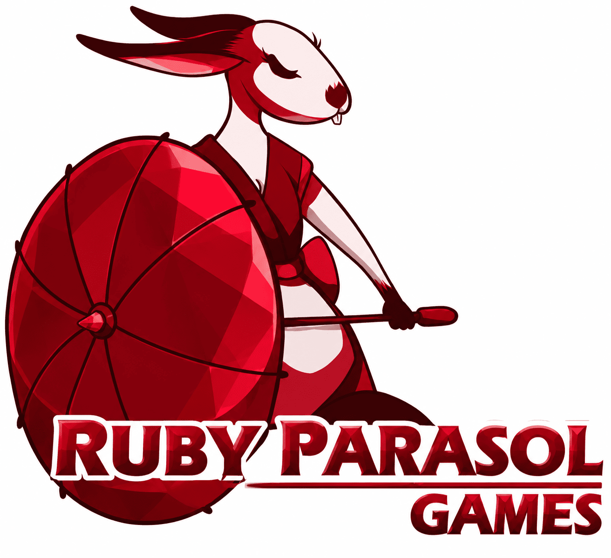

**[RUBY PARASOL GAMES] — COMUNICADO OFICIAL**

Olá, pessoal! Temos novidades sobre o desenvolvimento do nosso projeto *Help Wanted*!

Após uma longa jornada, a empresa para a qual havíamos confiado nosso projeto decidiu devolvê-lo, alegando ter encontrado uma criança e um coelho verde bastante suspeito durante o desenvolvimento de um port para dispositivos móveis.

Hmm... Parece que certas empresas sempre encontram motivos extremamente específicos para abandonar projetos, não é mesmo?

Brincadeiras à parte, o projeto está oficialmente de volta às nossas mãos!

Infelizmente, isso significa que teremos que **REFAZER ABSOLUTAMENTE TUDO DO ZERO**, pois a versão anterior apresentou um pequeno problema técnico: um GLITCH ROXO INSUPORTÁVEL que, por algum motivo misterioso, simplesmente se recusava a desaparecer.

Tentamos de tudo. O roxo venceu.

**PARABÉNS, STEEL WOLF STUDIOS.**

Mas não se preocupem! Estamos de volta ao trabalho, reconstruindo o projeto com melhorias, otimizações e muito cuidado para entregar a melhor experiência possível.

A partir de agora, compartilharemos atualizações sobre o desenvolvimento, novos recursos e cada avanço importante dessa jornada.

Fiquem de olho nas novidades da **Ruby Parasol Games**, porque, desta vez, vamos garantir que nosso projeto não desapareça no meio de um incidente misterioso de desenvolvimento.

**Ruby Parasol Games — Rebuilding the experience, one glitch at a time.**
